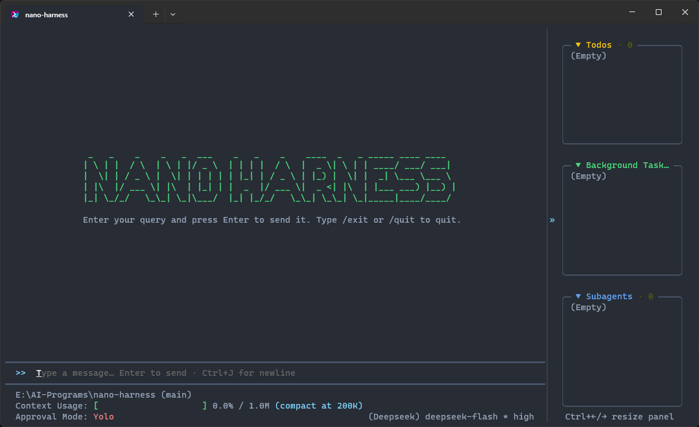

English | [简体中文](README.md)

# nano-harness

<p align="center">
  
</p>

<p align="center">
  <sub>Full-screen TUI: the card-based chat log and status line on the left, the Information panel (Todos / Background Tasks / Subagents) on the right</sub>
</p>

<p align="center">
  
  
  
</p>

A coding agent harness built with Python 3.13 and [Textual](https://textual.textualize.io/): full-screen TUI
chat, streaming tool calls, layered context compaction, background tasks, cron scheduling, and subagents.

> The source code is the documentation: most of the implementation lives in `core/`, the CLI entry point is
> `core/cli.py` (global commands `nh` / `nano-harness`), and `main.py` at the repository root is a thin wrapper
> that keeps `dev` as the default mode; the logging implementation is in `core/shared/logger.py`.

> The detailed documentation under [`docs/`](docs/) is currently available in Chinese only.

## Contents

- [Core Features](#core-features)
- [Quick Start](#quick-start)
- [Model Configuration](#model-configuration)
- [Using the TUI](#using-the-tui)
- [Configuration Directory](#configuration-directory)
- [Permission Policy](#permission-policy)
- [Extension System](#extension-system)
- [Project Layout](#project-layout)
- [Documentation Index](#documentation-index)

## Core Features

- **Full-screen TUI**: card-based chat log, streaming rendering of thinking and response text, tool calls and results (write / edit diffs are rendered in the same card), and a right-hand Information panel for Todos, Background Tasks, and Subagents;
- **Tool system**: file read/write/edit (`read_file` supports local png/jpg/jpeg/gif/webp images — ≤ 5 MB each, with automatic downscaling when oversized — and image URLs; images reach vision models as user messages), shell (slow commands move to the background automatically), glob / grep, clarify, and MCP tools merged into the pool;
- **Two-layer context compaction**: uniform truncation of tool output plus history summarization, with thresholds resolved dynamically for the current model;
- **Robustness**: Esc interruption, provider-specific error classification and backoff retries, automatic max-token escalation and continuation prompts after truncation, and each session message persisted to disk immediately;
- **Subagents**: their own prompts and tool pools; they run in the background for up to 30 rounds, return only the final text conclusion, and appear under their role label in the right-hand panel;
- **Extensibility**: allow / ask / deny permission rules in `.nano-harness/.permissions.json`, plus external extensions under `.nano-harness/extensions/` that hook into five events; their deciding votes in `before_tool` are adjudicated by the built-in permission gate.

## Quick Start

### Prerequisites

Python 3.13+ and [uv](https://docs.astral.sh/uv/). If uv is missing, install it with
`curl -LsSf https://astral.sh/uv/install.sh | sh` on macOS / Linux, or
`powershell -c "irm https://astral.sh/uv/install.ps1 | iex"` on Windows.

### Install

```bash
# 1. Clone the source from GitHub
git clone https://github.com/L-Karas/nano-coding-harness.git
cd nano-coding-harness

# 2. Install dependencies (requires-python >= 3.13; also installs nh into .venv)
uv sync

# 3. Install as a global command (run at the repo root): nh / nano-harness go into uv's shim directory, which must be on PATH
# Windows defaults to %USERPROFILE%\.local\bin; macOS / Linux default to ~/.local/bin
uv tool install --editable .
```

The repository directory is named `nano-coding-harness`, while the installed package and commands are
`nano-harness` / `nh`. An editable install uses the repository code directly, so code changes take effect
immediately (no reinstall is needed after `git pull`); reinstall with
`uv tool install --editable . --force` when dependencies or the version number change (for in-repo
`uv run` development, run `uv sync`), and uninstall with `uv tool uninstall nano-harness`.

### Run

```bash
nh                 # Start from any directory: prod by default (~/.nano-harness)
nh -dev            # Use .nano-harness in the current directory (same as uv run main.py)
nano-harness       # Long command, fully equivalent to nh

uv run main.py               # In-repo development: dev (.nano-harness lives in the project directory)
uv run main.py --production  # prod: .nano-harness lives in the home directory (~/.nano-harness)
```

On first launch the harness creates the `.nano-harness/` config and data directory for the current mode
(see [Configuration Directory](#configuration-directory)). The global command defaults to `prod`, keeping
configuration under `~/.nano-harness` and project directories clean; `-dev` / `-prod` can override the mode
at any entry point (mutually exclusive). The UI opens normally even with no model configured: enter an API
Key with `/provider`, pick a model with `/model`, and start chatting.

### Self-check

```bash
uv run pytest tests/                          # Unit tests
uv run python -m core.tui.ui_textual --smoke  # Headless TUI smoke self-check (rendering / streaming / completion / dialogs / permissions)
```

## Model Configuration

Built-in providers include Deepseek, Qwen, Kimi, and Z.AI (`core/client/models.json`); custom providers
can also be registered. For vision / thinking-level declarations and registry details, see
[`docs/configuration.md`](docs/configuration.md).

| Command | Description |
| --- | --- |
| `/provider` | Add/remove API Keys (written to `.nano-harness/.auth.json`) |
| `/model` | Switch the current session's model from the configured providers' model lists (changes only the in-memory client and is not persisted; the default model is changed in `/settings`) |
| `/effort` | Switch the thinking level (`minimal` / `low` / `medium` / `high` / `max`) |
| `/login` (alias `/logout`) | Register / unregister custom providers and models |

## Using the TUI

Two columns: the left side is the session (card-based chat log + status line + input bar + footer), and
the right side is the Information panel (Todos / Background Tasks / Subagents; collapsed by default,
expanded automatically when there is activity, and clickable to collapse). For layout and UI modules,
see [`docs/tui.md`](docs/tui.md).

### Keybindings

| Action | Description |
| --- | --- |
| `Enter` | Send the message when no candidates are shown; with `/` command candidates shown, complete the selection first, then send |
| `Shift+Enter` / `Ctrl+J` / `Ctrl+Enter` | Insert a newline (`Tab` does not indent; it is ignored) |
| `/` | Show command candidates; `Tab`/`Enter` complete the selection, `↑`/`↓` moves through candidates |
| `Tab` in the `/skills` window | Fill the selected skill's invocation into the input bar (without sending), so you can add a follow-up message and send both together |
| `Ctrl+E` in the `/skills` window | Enable/disable the selected skill; disabled skills are removed from the system prompt and rejected by `load_skill`; toggling again restores them |
| `Ctrl+E` in the `/mcp` window | Enable/disable the selected server; disabling disconnects it and removes its tools while keeping the config; toggling again reconnects |
| `@` | Show project file candidates (file/folder names in the left column, relative paths in the right); fills the input without sending |
| `Esc` | Dismiss candidates; deny the pending permission request; otherwise interrupt the current turn or an in-progress compaction |
| `Ctrl+C` | Does not exit (copies text when there is a selection); use `/exit` or `Ctrl+Q` to exit |
| `Ctrl+←` / `Ctrl+→` | Widen/narrow the Information panel (20%–40%); when collapsed, `Ctrl+←` expands it, and `Ctrl+→` at the narrowest width collapses it |
| Mouse | In most dialog lists, clicking a row is the same as `Enter` (in the unregister dialog a click only selects); chat cards and Information panel sections/entries are clickable; a `■` at the end of a running Background Tasks / Subagents row stops that specific item (handles remain valid across turns, see [ADR-0009](docs/adr/0009-background-cancel.md)); in `/settings`, clicking a toggle or dropdown option persists the change immediately, and clicking an input enters edit mode |

### Built-in Commands

| Command | Description |
| --- | --- |
| `/new` | New session |
| `/sessions` | Session picker |
| `/compact` | Compact the current context (can be interrupted with Esc) |
| `/fork` | List the current session's user messages; selecting one forks a new session just before that message and replays the history, with the original message text filled back into the input bar for editing |
| `/skills` | Skill list: Enter/click sends the skill as a turn; Tab fills the invocation into the input bar; `Ctrl+E` enables/disables the selected skill |
| `/extensions` | Extension list including disabled entries and an optional `description`; `[user]` / `[builtin]` mark the source, while disabled entries and entries that failed to load show `(disabled)` / `(error)` before the source; `Ctrl+E` enables/disables the selection |
| `/mcp` | List of MCP server names: Enter shows that server's tool list (failed or disabled servers cannot be viewed); `Ctrl+E` enables/disables the selected server; `Insert` opens the JSON config window and `Ctrl+S` persists it; `Delete` deletes the server |
| `/provider` | Add/remove API Keys |
| `/model` | Switch the current session's model |
| `/effort` | Switch the thinking level |
| `/settings` | Edit AgentConfig runtime parameters |
| `/login` (alias `/logout`) | Register/unregister custom providers and models |
| `/exit` (alias `/quit`) | Exit |

## Configuration Directory

The run mode determines where `.nano-harness/` lives: the global `nh` command defaults to `prod` (home
directory, shared across projects), while `uv run main.py` defaults to `dev` (the project directory);
`-dev` / `-prod` override this. Both modes use the same directory name, so the entire tree can be moved
as a unit. The working directory / tool sandbox is always the current project and never changes with
the mode. On first launch, `core.bootstrap.bootstrap()` creates the directory automatically (config,
sessions, skills, tasks, logs, and more; idempotent and thread-safe). For the full directory listing and
mode rules, see [`docs/configuration.md`](docs/configuration.md).

## Permission Policy

Every tool call is first adjudicated by the built-in permission gate (`before_tool`'s gate stage): the
hardcoded floor always denies dangerous terminal commands (`sudo`, etc.); users can write rules in
`.nano-harness/.permissions.json` (terminal command regexes plus `external_directory` policy / file-tool
path regexes plus outside-working-directory policy) to express allow / ask / deny; external extensions can also cast deciding votes via `decide()`,
and conflicts raise a confirmation card. For the decision order, rule format, and known risks, see
[`docs/permissions.md`](docs/permissions.md).

## Extension System

External extensions live in `.nano-harness/extensions/<name>/`. Without modifying the harness source, they
can hook into the main flow before/after LLM calls and before/after tool calls, or take over built-in
tool execution with `tool_execute`. For loading rules, event semantics, practical recipes, and
troubleshooting, see [`docs/extensions.md`](docs/extensions.md).

## Project Layout

| Path | Responsibility |
| --- | --- |
| `core/cli.py`, `main.py` | CLI entry point and the thin in-repo `dev` wrapper |
| `core/agent_loop.py`, `agent_step.py`, `turn_runtime.py` | Agent main loop, a single step (model call + tool dispatch), and the turn thread contract |
| `core/tui/` | Textual UI: app wiring, card / streaming rendering, commands and dialogs, Information panel |
| `core/tools/` | Tool base classes, registry, and `ToolPool`; built-in / extra tools and vision handling |
| `core/context/` | Session messages, two-layer context compaction, and long-term memory |
| `core/client/` | Provider / model registry and the streaming client |
| `core/extension/` | External extension system (events, stages, deciding votes) and built-in extensions (permission gate) |
| `core/mcp/` | MCP server connections and tool merging |
| `core/background_task.py`, `sub_agent.py`, `cron_scheduler.py` | Background tasks, subagents, and cron scheduling |
| `smoke/`, `tests/` | Headless TUI smoke self-check and unit tests |
| `docs/`, `examples/` | Project documentation and examples (config, extensions, s01–s18 tutorial scripts) |

For the full module map and main-loop details, see [`docs/architecture.md`](docs/architecture.md).

## Documentation Index

| Document | Contents |
| --- | --- |
| [`docs/architecture.md`](docs/architecture.md) | Module map of `core/`, the Agent main loop, two-layer context compaction, and robustness design |
| [`docs/tools.md`](docs/tools.md) | Tool system, built-in tool list, and background tasks |
| [`docs/tui.md`](docs/tui.md) | TUI layout and UI modules |
| [`docs/configuration.md`](docs/configuration.md) | Model registry, the `.nano-harness/` directory, `/settings` parameters, and compaction runtime parameters |
| [`docs/context-compaction.md`](docs/context-compaction.md) | Two-layer context compaction: triggers / retention budget, splitting and summarization, and behavior on model switch |
| [`docs/features.md`](docs/features.md) | MCP, Skills, Memory, and Cron scheduling |
| [`docs/permissions.md`](docs/permissions.md) | Permission policy: three-layer decision flow, rule file, extension deciding votes, and risks |
| [`docs/teams.md`](docs/teams.md) | Subagents: their own prompts, tool pools, and round limits |
| [`docs/extensions.md`](docs/extensions.md) | Complete guide to the external extension system |
| [`examples/`](examples/) | Screenshot `TUI.png`, config example `permission_config_example.json`, extension examples (`extension_example`, `jev-for-web-search`, `jev-for-terminal`), and tutorial scripts s01–s18 under `tutorials/` (agent-loop evolution examples; the teammate / task board / worktree features in s12 and s15–s18 are standalone prototypes that never made it into `core/`) |
